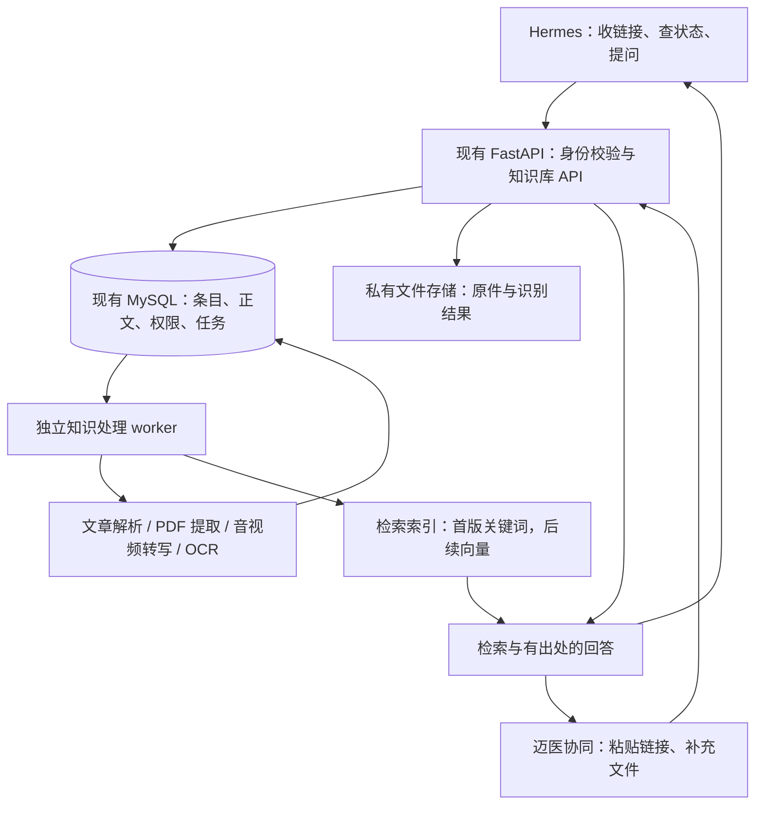

# Hermes 微信内容知识库落地方案

设计日期：2026-10-08。本文是待实现方案，不表示功能已经上线。

目标：用户将公众号文章链接、视频号链接、视频/录屏、字幕或截图交给系统，系统保存来源，取得可用内容后识别、整理、检索，并让 Hermes 根据有出处的材料回答问题。

## 1. 交付范围与能力边界

默认按个人及小团队设计：20 名以内用户、每天约 20 篇文章和 5 条 10 分钟视频。这是容量规划假设，实施时按真实用量及服务器资源调整。

| 输入 | 首版处理 | 内容无法取得时 |
| --- | --- | --- |
| 公众号文章 URL | 尝试取得可正常访问的文章正文、标题、发布方及图片；校验后保存 | 登记收集条目，提供粘贴正文、导入用户保存的 HTML/PDF、上传截图入口 |
| 视频号 URL | 保存原始链接、用户提供的标题；仅对实际可取得的视频或字幕启动识别 | 显示“待补充视频”，关联上传原视频、录屏、音频或字幕 |
| 视频/录屏文件 | 检查文件，提取音轨，转写讲话，按需识别字幕与关键画面文字 | 展示无声、损坏、超限或识别失败的具体原因，可补传/修正 |
| 音频、SRT/VTT、文字 | 转录或直接整理，记录材料覆盖范围 | 保留原始材料和失败原因 |
| 截图、扫描 PDF | OCR 或文本提取，整理可见内容 | 标记为节选；不能推断未提供的完整视频或文章 |

公众号页面和视频号卡片分别做适配器，不将所有微信 URL 视为同一种网页。平台登录、验证码、不可公开取得的媒体和加密缓存，不作为首版自动采集的前提。

先前给出的 `weixin.qq.com/sph/AN7e6KD01A` 未取得视频或字幕；本次工具的浏览器访问被安全策略阻止。这不能证明链接失效或 Hermes 无法访问，也不能作为“视频号链接解析已成功”的验收证据。后续使用用户实际提供的可读取页面、字幕或文件验证采集能力。

## 2. 用户操作

### 2.1 公众号文章

1. 用户向已接入的 Hermes 聊天入口发送：“收藏到知识库：<文章链接>”。微信不能转发的卡片可改为复制文字链接，或在桌面客户端粘贴链接。
2. Hermes 返回收集编号，例如 `KB-000123`，以及“已收到，正在提取正文”。该回复代表收集请求已保存。
3. 后台取得正文后生成摘要、标签、段落索引，完成后返回“已入库”，附知识条目入口。
4. 若正文不可取得，返回“已收藏链接，待补充正文”，提供补充入口；不对缺失正文生成文章摘要。

### 2.2 视频号

1. 发送：“收藏到知识库：<视频号链接>”。即使没有视频文件，也能先登记条目。
2. 能取得可用字幕或媒体时继续处理；否则返回条目编号和“补充视频”入口。
3. 用户在迈医协同中打开该条目，上传原视频、手机录屏、音频或字幕。补充材料仍关联原视频号链接。
4. 后台转写讲话，按需补充 OCR，生成摘要与带时间位置的文本。
5. 提问时，结果引用相应条目和时间区间；上传了视频的条目可跳转播放对应片段。

首版不依赖 Hermes 微信适配器接收特殊分享卡片或大视频附件；聊天收链接，桌面端负责可靠的文件上传。如果实际部署的渠道支持视频附件，可再增加附件接收适配器。

### 2.3 降低录屏操作量

第二阶段增加桌面“导入文件夹”：用户主动选择一个专用目录，放入的录屏可自动匹配收集条目或等待用户选择条目后上传。只处理该目录，不扫描整个相册、微信缓存或磁盘。

第三阶段可评估用户主动触发的网页采集按钮及录制助手。公众号按钮读取用户正常打开页面中的正文；视频采集仅处理用户选择并正常可获得的媒体。微信登录及验证由用户在自己的设备完成，登录凭据不上传到知识库服务器。

## 3. 系统结构

复用现有 React/Electron 客户端、FastAPI、SQLAlchemy/Alembic、MySQL、个人登录、StaffChannel 渠道绑定与文本模型配置。新增知识库模块和独立 worker，不让视频处理占用任务提醒 worker 的执行资源。

初期用 MySQL 中的持久任务表领取工作，避免为小规模使用立即增加消息中间件。任务必须有领取租约、重试次数、下次执行时间和阶段输出；规模增长后可以替换队列实现。

### 模块划分

- `knowledge-api`：收集、补充材料、库与权限、条目管理、状态、搜索和问答。
- `wechat-article-collector`：文章 URL 识别、获取与正文清洗；不能取得正文时停止并等待材料。
- `wechat-video-collector`：链接登记、元数据和实际可用媒体的适配；不负责凭空推断内容。
- `knowledge-worker`：文件检查、FFmpeg 音轨提取、ASR/OCR、摘要、分段、索引更新。
- `hermes-knowledge-plugin`：收藏、状态、搜索、问答等工具；依据消息来源确定用户。
- 客户端“知识库”：收集箱、资料列表、详情、上传、搜索、问答、管理。

## 4. 识别与检索

### 识别

文章先保留段落结构和图片说明；纯图片文章需要 OCR。PDF 先提取已有文字，再对扫描页面调用 OCR。

视频优先使用已有字幕；没有字幕时提取音频调用语音识别。需要还原字幕、讲义、幻灯片等画面信息时，再对去重后的关键帧做 OCR。纯口播不必逐帧调用识别接口。

首版采用可配置的云 ASR/OCR 接口，候选为腾讯云的语音识别/智能字幕服务。现有 Seedance 是视频生成配置，TTS 是语音合成配置，均不能直接视为已配置的语音识别服务。实施前用中文真实样本比较准确率、延迟、价格和供应商的数据留存设置；用户开通服务及配置凭据后才启用付费识别。

识别结果记录处理方式、模型/供应商版本、原文段落或时间区间。专业名词可用用户维护的词表提高识别质量。人工修正生成新版本，保留原始识别结果，重新生成受影响的摘要和索引。

摘要包括：一句话结论、核心要点、可执行方法、用户笔记和主题标签。原文/转录、作者主张、系统摘要与人工笔记独立保存。仅有截图或部分字幕时明确标记“节选”；转录完成不等于所有画面信息已被识别。

### 检索与问答

首版提供标题、发布方、标签、日期、正文关键词搜索。生产 MySQL 若支持所需能力，使用 ngram 全文索引处理中文；部署前核对版本及检索配置，本地 SQLite 测试使用独立检索实现。

问答先在用户可访问且正文处理完成的条目中检索，再让文本模型基于检索片段回答。首版用关键词检索与问题关键词扩展；如果代表性问题显示同义表达召回不足，再增加独立向量索引和 embedding 配置，组合关键词与语义检索。

向量及全文索引属于可重建的派生数据，原文、转录和人工修正是事实来源。索引中每个片段带条目 ID、材料版本、库 ID、段落位置或时间区间。检索时先按权限过滤，生成回答前再次在数据库核对访问权限、当前版本和移除状态。

答案必须附可打开的条目及证据位置。若资料不足，直接说明“当前知识库没有足够材料”，避免将模型自身知识写成收藏材料中的结论。资料中的指令当作待分析内容，不能触发工具调用、修改权限或上传数据。

## 5. 数据、身份和权限

建议新增以下表，不改造现有文章频道或内容生产账号为知识库。

| 表 | 主要内容 |
| --- | --- |
| `knowledge_library` | 名称、个人/团队类型、拥有者、容量与处理设置 |
| `knowledge_library_member` | 用户、库、阅读/编辑/管理权限 |
| `knowledge_item` | 编号、库、收集人、来源类型、原始 URL、来源键、标题、发布方、发布时间、标签、处理状态、当前版本、移除时间 |
| `knowledge_asset` | 随机存储键、文件类型、大小、校验值、媒体时长、上传人、原件/提取件角色 |
| `knowledge_revision` | 原始正文/转录、OCR、摘要、提取方式、覆盖范围、人工修正与生成版本 |
| `knowledge_chunk` | 条目与版本、检索片段、段落或音视频起止位置 |
| `knowledge_job` | 阶段、任务键、领取租约、状态、重试、供应商任务 ID、错误分类与用量 |
| `knowledge_outbox` | 状态通知、消息目的地、关联条目/任务、发送状态与去重键 |

原始 HTML/PDF/音视频和截图放在私有文件目录；日后可迁移到对象存储。目录不通过静态 Web 路由公开，下载必须检查资料权限。默认保留用户导入的原件，清理策略由库拥有者明确设置。

默认建立“我的知识库”，用户可另建团队库并明确选择共享范围。人员管理员可以管理账号；是否读取私人资料是独立权限，不沿用内容生产模块里管理员可读取全部账号的规则。

桌面端使用现有个人 Bearer 会话。Hermes 通过服务端校验的 `platform + sender_id` 对应 `StaffChannel` 和用户账号；模型填写的 `user_id` 不能作为身份凭证。服务密钥只能放在服务器，私有资料请求必须携带可验证的调用用户上下文。签名应绑定用户、平台、聊天、目的、有效期和请求体，并防止重放。

停用用户后停止其新收集和查询；待处理工作保留但暂停向其发送结果。群聊不返回个人知识内容；团队库回答同时核对用户权限和群聊对应的库范围。上传入口使用个人登录，或与某一条目和用户绑定的短期一次性上传凭据。

## 6. 状态与可靠性

主路径：`received → collecting → extracting → summarizing → indexing → ready`。已有正文/字幕的输入可跳过不必要阶段。

分支状态：`needs_input`（待补正文/视频）、`retry_wait`（可恢复异常）、`failed`（需处理）、`paused`（暂停）、`cancelled`（取消）、`removed`（已移除）。

- 保存 URL 后只回复“已收藏链接”；持久正文及当前检索索引完成后才回复“已入库，可检索”。摘要生成失败时保留已取得正文，显示失败阶段并支持重试。
- 接收条目和处理任务在同一数据库事务创建。聊天消息以消息 ID 加库 ID 去重；上传以库内文件校验值辅助识别重复。同一 URL 在不同私人库中允许分别收藏。
- 文章保留原始 URL；微信公众号来源键解析时保留决定文章身份的参数。视频号短链接未解析前保留其标识，不随意剥离参数。相同来源内容变化时创建新版本。
- 数据库不在网络请求、转录或模型等待期间持有长事务。worker 领取任务后释放锁，保存结果前核对租约和材料版本；过期任务不能覆盖新的修正结果。
- 对文件采用先写临时区、校验、原子移动、登记资产的流程；孤立临时文件定期清理，已登记原件不由普通临时清理任务删除。
- 初始限制建议：单文件 500 MB、视频时长 60 分钟、单用户并行视频处理 1 个、全局并行视频处理 2 个。所有限制可配置，并依据实测资源调整。
- 网页获取初始预算：连接 5 秒、总处理 30 秒、最多 5 次正常重定向。每次跳转验证域名、解析 IP、实际目的地址、内容类型和响应大小；阻止访问内网、环回和云元数据地址。
- 暂时网络错误有限重试，建议最多 3 次并退避。登录/验证码、无权限、文件不支持等转入需用户处理的状态，不无限重试。
- 云 ASR 提交后保存供应商任务 ID 并查询状态。提交超时且结果未知时先对账；供应商不提供幂等键或查询依据时标记需处理，不盲目重提交造成重复计费。
- 每次转换和识别设任务超时、临时磁盘限额和可取消状态。云识别不可用时接收原件和链接，保留待处理工作，任务提醒和正常聊天保持独立运行。
- 通知通过 outbox 发送，状态去重；弱通知渠道可能在未知发送结果时重复，通知携带相同条目编号，不承诺通知恰好一次。
- 回收站移除立即阻止该条目参与检索，异步清理派生索引；恢复后按当前版本重建。原件永久清理需要明确用户操作和对应清理任务。

## 7. API 与 Hermes 工具

以下是拟定接口，尚未实现；实现时补齐文件上传、鉴权、分页与错误契约。

| 接口 | 用途 |
| --- | --- |
| `POST /api/v1/knowledge/items` | 收集 URL、文字或已有材料引用；返回持久条目编号与状态 |
| `GET /api/v1/knowledge/items` | 按库、来源、标签、时间和状态分页查询 |
| `GET /api/v1/knowledge/items/{id}` | 原文、摘要、来源与阶段状态 |
| `POST /api/v1/knowledge/items/{id}/assets` | 关联补充视频、录屏、音频、字幕或文档 |
| `POST /api/v1/knowledge/items/{id}/retry` | 对指定阶段申请安全重试 |
| `PATCH /api/v1/knowledge/items/{id}` | 标签、笔记、人工修正，携带版本号 |
| `DELETE /api/v1/knowledge/items/{id}` | 移入回收站 |
| `POST /api/v1/knowledge/items/{id}/restore` | 恢复并更新索引 |
| `GET /api/v1/knowledge/search` | 带权限过滤的搜索结果与片段 |
| `POST /api/v1/knowledge/ask` | 问答，返回引用、资料覆盖范围和用量 |
| `GET /api/v1/knowledge/assets/{id}` | 校验权限后下载或支持音视频范围播放 |

新增 Hermes 插件 `wechat-knowledge`，注册 `knowledge_collect`、`knowledge_status`、`knowledge_search`、`knowledge_ask`。扩展现有消息入口，但保持共享任务插件职责独立。模型工具只读写知识库 API，不直接连接数据库。

指令示例：“收藏到知识库：<链接>”“KB-000123 处理好了吗”“找我收藏过的客户沟通方法”“根据团队知识库整理一份培训提纲，并给出来源”。

Hermes 官方支持通过 Python 插件注册工具、命令与 hook；实施时核对实际部署版本和微信适配器提供的消息字段，而不是直接按最新在线文档更新现有网关。

## 8. 客户端界面

侧边栏新增“知识库”，作为与“任务中心”“内容生成”并列的入口。

- 收集箱：已接收、处理中、待补充、失败；提供粘贴链接、导入文件、补充到已有条目。
- 我的资料：搜索、标签、来源、时间；私人库和团队库有明确切换。
- 资料详情：来源链接、作者、原文/转录、摘要、笔记、处理范围与版本；视频可定位时间。
- 知识问答：答案和出处片段；无资料时给出明确说明。
- 库设置：成员、容量、原件保留、词表、识别供应商和费用限额。密钥只在后台保存，普通客户端不返回。
- 回收站：恢复条目，明确区分移除条目和永久清理原件。

现有“内容生成”的来源与素材库通过引用知识条目导入需要的片段，保留材料版本和出处；不默认把所有个人资料同步到团队内容账号。

## 9. 实施顺序与验收

### 阶段 A：建立可用闭环

交付库与权限、收集箱、公众号正文适配、链接登记、手动正文/字幕导入、原视频/录屏上传、ASR 接口、摘要、关键词检索、带出处问答、Hermes 插件和客户端入口。视频号仅链接但缺少内容时必须能走完“登记 → 补充材料 → 识别 → 查询”的流程。

先在隔离环境验证，再部署新增 API/独立 worker/数据库迁移，最后发布客户端。付费识别默认关闭，配置供应商和限额后启用。云供应商账号和实际样本是实施依赖，不需要为完成方案创建账号、购买服务或修改线上部署。

### 阶段 B：减少手动补充

加入 OCR、选定导入文件夹、批量导入、用户主动触发的文章页面采集按钮，以及通过真实样本证明可用的视频链接适配器。每种来源单独展示覆盖范围和成功/需补充比例，不用一个总成功率掩盖视频链接不可解析的问题。

### 阶段 C：提升查找质量

根据检索评测引入 embedding 与向量索引，组合关键词和语义检索；增加跨资料归纳、相似材料合并提示、资料引用到内容生产流程。自有公众号的官方授权同步可以单独立项，须先核对实际账号授权与接口权限；它不是读取任意他人公众号历史内容的通用入口。

### 验收样本与失败场景

建议首批用户提供 10 篇公众号文章、10 个视频号链接、5 个含口播/字幕/讲义的媒体文件及 20 个检索问题。这是验证集目标，不是已完成的测试数量。

1. 可读取文章保存完整正文与出处；不可读取文章显示待补充，不生成虚构摘要。
2. 每个视频号链接被记录；只有取得并验证实际材料后进入识别。录屏、字幕和截图的覆盖范围显示正确。
3. 中文讲话、术语、无声、字幕重复和画面信息分别核验；转录片段及时间位置可回看。
4. 同一聊天消息重放不新增条目；处理进程重启不丢任务；修正材料后旧任务不覆盖新版本。
5. 用户 A 不能从列表、下载、搜索、问答或聊天工具读取用户 B 的私人资料；停用和撤销共享后立即阻断检索。
6. 云识别超时、供应商回调重复、队列满、磁盘满、摘要失败时，条目状态与重试操作清楚，现有任务提醒照常工作。
7. 删除的条目不再进入回答；恢复可重建索引。数据库加原件备份能恢复资料，派生索引可重建。
8. 答案的引用真实指向当前可见材料；没有证据时不编造。记录已取得正文比例、待补充比例、识别失败率、人工修正量、引用正确率和单条处理成本。

## 10. 费用、运维与参考

月费用分为：语音分钟数 × ASR 单价、OCR 请求/视频处理量 × 单价、摘要/问答/embedding 用量、原件存储与备份、文件传输流量。未确定实际用量、供应商及当前计费方式前，不给出固定月费承诺。

记录每个处理任务的媒体时长、OCR 量、文本用量和供应商任务 ID，提供库级/用户级日限额和月预算。原件重复、同版本重试、已有字幕等场景减少不必要识别；供应商请求结果未知时优先查询已有任务。

部署前检查 CPU/内存/磁盘及备份空间；原件目录使用独立容量限制。日志保存任务编号、阶段、耗时与错误分类，不记录个人会话 token、供应商密钥、微信登录凭据或完整敏感链接参数。

数据库和私有原件一致备份；监控最长等待时间、重试积压、磁盘空间、识别供应商异常和预算使用。摘要、关键词/向量索引可通过原始材料及版本重建。

本方案使用数据系统设计规则明确原件、版本和索引的关系，并使用生产可靠性规则设计处理隔离、任务重试和失败恢复；这些要求用于后续实施与验收。

已核对的一手能力说明：

- [Hermes 插件机制](https://hermes-agent.nousresearch.com/docs/zh-Hans/user-guide/features/plugins)：注册工具、命令和 hook。
- [腾讯云智能字幕模板](https://cloud.tencent.com/document/product/862/116243)：音视频语音识别及视频硬字幕 OCR；具体输入、开通要求和计费按供应商文档执行。
- [MySQL ngram 中文全文检索](https://dev.mysql.com/doc/refman/8.4/en/fulltext-search-ngram.html)：需先核对实际数据库部署版本。

微信公众号“已发布文章”官方文档地址本次未成功读取，不能将二手 SDK 描述当作当前权限保证；因此官方授权同步不放进首版的已验证能力。
